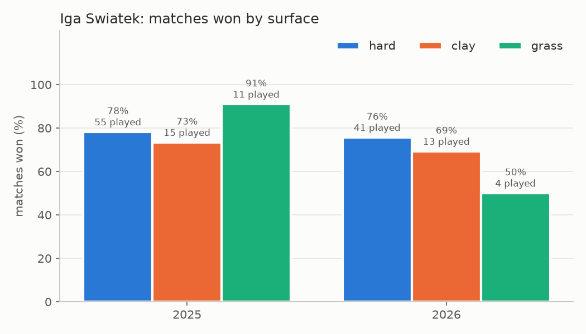

# Tennis head-to-head stats in Python (ATP & WTA)

Small, runnable examples for pulling tennis **head-to-head records** and
**player match history** into pandas, using the
[Tennis Player Stats & H2H Scraper](https://apify.com/incognito_mode/tennis-player-stats-h2h-scraper)
on Apify (data from Sofascore).

| File | What it does |
| --- | --- |
| `h2h.py` | `python h2h.py "Sinner vs Alcaraz"`: overall tally, split by surface, last 5 meetings, every meeting saved to `h2h.csv` |
| `career.py` | `python career.py "Iga Swiatek" --stats`: every match this season and last, win % by surface per season, first-serve % per match |
| `tennis_h2h.ipynb` | Both of the above in one notebook, with outputs and charts |
| `common.py` | Runs the Actor, prints what the run cost, and flattens rows into a DataFrame |



## Setup

```bash
python -m venv .venv && . .venv/bin/activate
pip install -r requirements.txt
export APIFY_TOKEN=...   # https://console.apify.com/settings/integrations
```

For the notebook, also `pip install jupyter` and start it from the same shell,
so it sees `APIFY_TOKEN`.

## What it costs

The Actor is priced per match row ($2.50 per 1,000), plus $1 per 1,000 for
each add-on (statistics, odds). Every run prints its own cost.

| Run | Rows | Cost |
| --- | ---: | ---: |
| `h2h.py "Sinner vs Alcaraz"` | 18 matches + 1 free summary | $0.045 |
| `career.py "Iga Swiatek" --stats` | 139 matches with statistics | $0.49 |

The free Apify plan's $5 monthly credit covers both several times over.

## How the data is shaped

- One row per match from a player's side: `perspectivePlayer`, `opponent`,
  `won`, `scoreForPlayer`, `surfaceCategory`, `tournamentName`, `round`,
  `resultType` (completed, retired, walkover), and more.
- Each pair also gets a free `rowType: "h2h"` row with `playerAWins`,
  `playerBWins` and `bySurface`.
- `statistics` and `odds` keep Sofascore's home/away order (`player1` =
  home). `common.stat_for_player` picks the right side for you.

## License

MIT for the code in this repository (see `LICENSE`). Check Sofascore's terms
for how you use the data.
